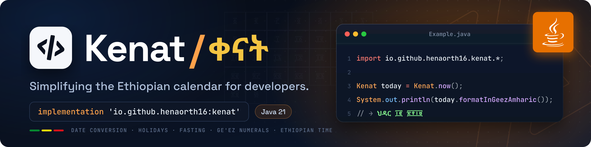

# Kenat Java



[](https://openjdk.org/projects/jdk/21/)
[](LICENSE)
[](lib/build.gradle.kts)

A modern **Java 21** library for Ethiopian calendar (Ge'ez / Ethiopic) arithmetic, formatting, holiday and fasting calculations.

> This is an independent Java rewrite of the original [**Kenat**](https://github.com/MelakuDemeke/kenat) TypeScript library by [Melaku Demeke](https://github.com/MelakuDemeke), built from scratch using idiomatic Java — not a line-by-line translation.

---

## Features

- 🗓 **Ethiopian ↔ Gregorian conversion** — accurate multi-century date math
- 📅 **Month & year grid generation** — 7-column calendar grid with holidays and padding
- 🕰 **Ethiopian time** — 12-hour Ethiopian clock ↔ 24h Gregorian; add/subtract/diff
- 🔢 **Ge'ez numerals** — integers ↔ Ethiopic script (supports 0–99,999,999)
- 📖 **Localized output** — Amharic and English month/weekday names
- 🎉 **Holiday lookup** — fixed, movable Christian, and Islamic holidays
- 🕌 **Orthodox commemorations** — the monthly saints/nigs calendar, overlaid on the month grid
- 🙏 **Fasting periods** — Abiy Tsome, Tsome Hawaryat, Nineveh, Tsome Nebiyat, Filseta, Ramadan, Tsome Dihenet
- 📐 **Date arithmetic** — add/subtract days/months/years; full diff breakdown
- 📏 **Distance helpers** — human-readable "how far to Fasika?" breakdowns in Amharic or English
- ✅ **Bahire Hasab** — complete movable feast algorithm (Enkutatash, Timkat, Easter, Pentecost, etc.)
- 🧩 **Clean API** — Java 21 records, `java.time` integration, immutable types, no external dependencies

This release tracks the reference TypeScript library [`kenat` v4.x](https://github.com/MelakuDemeke/kenat)
feature-for-feature. See [Parity with the TypeScript library](#parity-with-the-typescript-library)
for the handful of places where the two deliberately differ.

---

## Installation

Available on [Maven Central](https://central.sonatype.com/artifact/io.github.henaorth16/kenat) as `io.github.henaorth16:kenat:1.1.0`. Requires **Java 21+**.

### Gradle (Kotlin DSL)

```kotlin
repositories {
    mavenCentral()
}

dependencies {
    implementation("io.github.henaorth16:kenat:1.1.0")
}
```

### Gradle (Groovy DSL)

```groovy
dependencies {
    implementation 'io.github.henaorth16:kenat:1.1.0'
}
```

### Maven

```xml
<dependency>
    <groupId>io.github.henaorth16</groupId>
    <artifactId>kenat</artifactId>
    <version>1.1.0</version>
</dependency>
```

### Local development

To build and install the current source into your local Maven repository:

```bash
git clone https://github.com/henaorth16/kenat-java.git
cd kenat-java
./gradlew publishToMavenLocal
```

Then add `mavenLocal()` to your `repositories` block (before `mavenCentral()`).

---

## Quick Start

```java
import io.github.henaorth16.kenat.*;

// Today's Ethiopian date
Kenat today = Kenat.now();
System.out.println(today.format());                      // "ሐምሌ 15 2016"
System.out.println(today.format("english"));             // "Hamle 15 2016"
System.out.println(today.formatShort());                 // "2016/07/15"
System.out.println(today.formatInGeezAmharic());         // "ሐምሌ ፲፭ ፳፻፲፮"

// Convert Ethiopian → Gregorian
EthiopianDate eth = new EthiopianDate(2016, 3, 15);      // Hidar 15, 2016 EC
GregorianDate  greg = Conversions.toGC(eth);
System.out.println(greg.toLocalDate());                  // 2023-11-25

// Convert Gregorian → Ethiopian
EthiopianDate back = Conversions.toEC(LocalDate.of(2023, 11, 25));
System.out.println(back);                                // 2016/03/15

// Date arithmetic — immutable, chainable
Kenat nextMonth = Kenat.now().add(1, "months");
Kenat lastWeek  = Kenat.now().subtract(7, "days");

// Diff
Kenat a = new Kenat("2016/1/1");
Kenat b = new Kenat("2017/3/15");
System.out.println(a.diffInDays(b));   // -434
System.out.println(a.diffInYears(b));  // -1
```

---

## API Overview

### `Kenat` — main facade

```java
// Constructors
new Kenat()                              // today
new Kenat("2016/1/1")                    // from Ethiopian date string (yyyy/mm/dd or yyyy-mm-dd)
new Kenat(new EthiopianDate(2016, 1, 1)) // from record
new Kenat(LocalDate.of(2023, 9, 12))     // from Gregorian LocalDate
Kenat.now()                              // static factory

// Getters
k.getEthiopian()    // EthiopianDate
k.getGregorian()    // GregorianDate
k.getTime()         // EthiopianTime

// Formatting
k.format()                                        // "መስከረም 1 2016" (Amharic)
k.format("english")                               // "Meskerem 1 2016"
k.format("ethiopian","amharic", true, true, true) // weekday + Geez + time
k.formatShort()                                   // "2016/01/01"
k.formatInGeezAmharic()                           // "መስከረም ፩ ፳፻፲፮"
k.formatWithWeekday("amharic", false)
k.toISOString()                                   // "2016-01-01T12:00" (Ethiopian)
k.toISOString("gregorian")                        // "2023-09-12T06:00" (true ISO 8601)
k.toString()                                      // "መስከረም 1 2016 12:00 ጠዋት"

// Arithmetic (all return new Kenat)
k.add(3, "days")   .add(1, "months").add(2, "years")
k.subtract(1, "months")
k.addDays(n)  .addMonths(n)  .addYears(n)

// Diff
k.diffInDays(other)    // int
k.diffInMonths(other)  // int
k.diffInYears(other)   // int

// Comparison
k.isBefore(other)  .isAfter(other)
k.isSameDay(other) .isSameMonth(other) .isSameYear(other)

// Boundaries
k.startOf("month")  .endOf("month")
k.startOf("year")   .endOf("year")
k.startOfMonth()    .endOfMonth()          // shorthand

// Calendar queries
k.isLeapYear()      // true when Pagume has 6 days
k.weekday()         // 0 = Sunday … 6 = Saturday
k.getCurrentTime()  // system clock as EthiopianTime

// Distance
k.distanceTo(other)                        // DiffBreakdown
k.distanceTo(other, EnumSet.of(DiffUnit.DAYS))
k.distanceFromToday()
Kenat.distanceToHoliday("fasika")          // nearest occurrence
Kenat.distanceToHoliday("fasika", Kenat.HolidayDirection.FUTURE, null);
Kenat.formatDistance(k.distanceFromToday());                    // "1 year 2 months 5 days"
Kenat.formatDistance(k.distanceFromToday(), null, "amharic");   // "1 ዓመት 2 ወር 5 ቀን"

// Bahire Hasab
BahireHasab.BahireHasabResult bh = k.getBahireHasab();
bh.movableFeasts().get("fasika");    // Easter this year

// Holiday check
List<Holiday> holidays = k.isHoliday();  // empty if not a holiday

// Calendar grids (static)
Kenat.getMonthGrid(2016, 1)              // MonthGridResult
Kenat.getYearCalendar(2016)              // List<MonthGridResult> (13 months)
Kenat.generateDateRange(start, end)      // List<Kenat>

// Day listings and text rendering
k.getMonthCalendar()                     // List<CalendarDay> for this month
k.getMonthCalendar(2016, 1, true)        // arbitrary month, Ge'ez numerals
k.printThisMonth()                       // ASCII grid to System.out
```

### Conversions

```java
GregorianDate g = Conversions.toGC(2016, 1, 1);
EthiopianDate e = Conversions.toEC(2023, 9, 12);
LocalDate     d = Conversions.toGCDate(2016, 1, 1);
EthiopianDate e2 = Conversions.toEC(LocalDate.now());
```

### DayArithmetic

```java
EthiopianDate d  = new EthiopianDate(2016, 1, 1);
EthiopianDate d2 = DayArithmetic.addDays(d, 45);
EthiopianDate d3 = DayArithmetic.addMonths(d, 3);
int days         = DayArithmetic.diffInDays(d, d2);
DiffBreakdown br = DayArithmetic.diffBreakdown(d, d2, null); // all units
br.yearsOpt();   // OptionalInt
br.monthsOpt();
br.daysOpt();
```

### GeezConverter

```java
String geez = GeezConverter.toGeez(2016);   // "፳፻፲፮"
int    n    = GeezConverter.toArabic("፳፻"); // 2000
```

### EthiopianTime

```java
EthiopianTime t  = new EthiopianTime(6, 30, TimePeriod.DAY);
EthiopianTime t2 = EthiopianTime.fromGregorian(12, 30);  // 12:30 Gregorian → 6:30 Ethiopian day
EthiopianTime t3 = EthiopianTime.fromString("6:30 night");
t.toGregorian();         // int[]{18, 30}
t.add(2, 15);            // +2h15m → new EthiopianTime
t.format();              // "፮:፴ ጠዋት"
t.format("english", false, true, false);  // "06:30 day"
```

### Holidays

```java
Holiday h = Holidays.getHoliday("fasika", 2016);
List<Holiday> month  = Holidays.getHolidaysInMonth(2016, 1, "amharic");
List<Holiday> year   = Holidays.getHolidaysForYear(2016, "english");
// Filter by tag
List<Holiday> pub = Holidays.getHolidaysForYear(2016, "amharic",
                        List.of(HolidayTags.PUBLIC));
```

### Fasting

```java
Optional<DateRange>          period = Fasting.getFastingPeriod(FastingKeys.ABIY_TSOME, 2016);
Optional<Fasting.FastingInfoResult> info = Fasting.getFastingInfo(FastingKeys.RAMADAN, 2016, "english");
List<Integer> days = Fasting.getFastingDays(FastingKeys.TSOME_DIHENET, 2016, 3);
```

### BahireHasab

```java
var bh = BahireHasab.getBahireHasab(2016);
System.out.println(bh.ameteAlem());          // 7516
System.out.println(bh.evangelistName());     // "ዮሐንስ"
System.out.println(bh.ninevehDate());        // EthiopianDate
bh.movableFeasts().forEach((key, h) ->
    System.out.println(key + ": " + h.ethiopian()));
```

### MonthGrid

```java
var config = new MonthGrid.MonthGridConfig(2016, 1, 1, false, "amharic", null, "public", false);
MonthGrid.MonthGridResult grid = MonthGrid.create(config);
grid.headers();     // ["ሰኞ", "ማክሰኞ", ...]
grid.days();        // List<MonthGridDay | null> — null = padding
grid.monthName();   // "መስከረም"

// Navigation — returns a fresh grid with the same settings
grid.up();          // next month (Pagume rolls into Meskerem of the next year)
grid.down();        // previous month
```

The `mode` field decides what lands on each day cell:

| `mode` | Day cells carry |
|--------|-----------------|
| `"christian"` | Christian holidays **+** the Orthodox monthly commemorations for that day |
| `"muslim"` | Muslim holidays **+** a `jummah` entry on every Friday |
| `"public"` | Public holidays only |
| `null` | No mode filter; `holidayFilter` applies as given |

In `"christian"` mode only *nigs* days appear by default — commemorations whose
`negs` list contains the rendered month. Set `showAllSaints` to surface every
commemoration recorded for the day; those carry the `SAINT_DAY` tag instead of `NIGS`.

### OrthodoxCommemorations

The monthly saints calendar backing `"christian"` mode is also directly queryable:

```java
List<OrthodoxCommemorations.Commemoration> firstOfMonth = OrthodoxCommemorations.forDay(1);
firstOfMonth.get(0).name().amharic();   // "ልደታ ማርያም"
firstOfMonth.get(0).isNigsIn(9);        // true — a nigs in Ginbot
OrthodoxCommemorations.byDay();         // the whole day → commemorations map
```

Data lives in the bundled classpath resource `kenat/nigs.json` and is parsed by a
small internal reader, so the library still ships with zero runtime dependencies.

---

## Parity with the TypeScript library

The Java port tracks `kenat` v4.x. Two behaviours deliberately differ, each for a
stated reason:

| Area | TypeScript | Java | Why |
|------|-----------|------|-----|
| Islamic holiday dates | `Intl.DateTimeFormat` with ICU's astronomical `islamic` calendar | JDK `HijrahChronology` (Umm al-Qura) | No external dependency, deterministic across JVMs, and matches the observed civil dates. Eid al-Fitr can land one day later than the TS result (e.g. 2016 EC: Miazia 2 here, Miazia 1 there). |
| Error types | Error objects with `toJSON()` | Unchecked exceptions rooted at `KenatException` | Idiomatic Java; structured fields are exposed as getters. |

Everything else — conversions, Bahire Hasab, holidays, fasting, formatting, Ge'ez
numerals, time, month grids — matches the TypeScript fixtures exactly.

---

## Core Types

| Type | Description |
|------|-------------|
| `EthiopianDate` | Immutable record — Ethiopian year, month (1–13), day |
| `GregorianDate` | Immutable record — Gregorian year/month/day with `toLocalDate()` |
| `EthiopianTime` | Mutable value — hour 1–12, minute, `TimePeriod` |
| `LocalizedText` | Amharic + English + optional extras map |
| `Holiday` | Key, tags, movable flag, name, description, Ethiopian + Gregorian dates |
| `DateRange` | Inclusive Ethiopian date range (start, end) |
| `DiffBreakdown` | sign, totalDays, optional years/months/days |
| `Language` | Enum: `AMHARIC`, `ENGLISH` |
| `TimePeriod` | Enum: `DAY`, `NIGHT` |
| `DiffUnit` | Enum: `YEARS`, `MONTHS`, `DAYS` |

## Exceptions

All extend `KenatException` (unchecked):

| Exception | When thrown |
|-----------|-------------|
| `InvalidEthiopianDateException` | Out-of-range Ethiopian date |
| `InvalidGregorianDateException` | Out-of-range Gregorian date |
| `InvalidDateFormatException` | Malformed date string |
| `UnrecognizedInputException` | Unknown enum key or identifier |
| `GeezConverterException` | Invalid Ge'ez numeral input |
| `InvalidInputTypeException` | Wrong argument type |
| `InvalidTimeException` | Invalid Ethiopian time values |
| `InvalidGridConfigException` | Bad month-grid configuration |
| `UnknownHolidayException` | Unrecognised holiday key |

---

## Project Structure

```
kenat-java/
├── lib/
│   └── src/
│       ├── main/java/io/github/henaorth16/kenat/
│       │   ├── Kenat.java                   ← main facade
│       │   ├── Conversions.java
│       │   ├── DayArithmetic.java
│       │   ├── EthiopianCalendarUtils.java
│       │   ├── GeezConverter.java
│       │   ├── EthiopianTime.java
│       │   ├── Formatting.java
│       │   ├── BahireHasab.java
│       │   ├── Holidays.java
│       │   ├── Fasting.java
│       │   ├── MonthGrid.java
│       │   ├── MonthCalendarPrinter.java
│       │   ├── OrthodoxCommemorations.java
│       │   ├── internal/Json.java          ← dependency-free JSON reader
│       │   ├── EthiopianDate.java
│       │   ├── GregorianDate.java
│       │   ├── LocalizedText.java
│       │   ├── Holiday.java
│       │   ├── DateRange.java
│       │   ├── DiffBreakdown.java
│       │   ├── DiffUnit.java
│       │   ├── Language.java
│       │   ├── TimePeriod.java
│       │   ├── HolidayTags.java
│       │   ├── FastingKeys.java
│       │   ├── KenatConstants.java
│       │   └── exception/           ← 10 typed exception classes
│       ├── main/resources/kenat/
│       │   └── nigs.json            ← Orthodox monthly commemorations
│       └── test/java/io/github/henaorth16/kenat/
│           ├── ConversionsTest.java             ← ports ../kenat/tests/conversions.test.ts
│           ├── DayArithmeticTest.java           ← ports dayArtimetic.test.ts
│           ├── BahireHasabTest.java             ← ports bahireHasab.test.ts
│           ├── HolidaysTest.java                ← ports holidays.test.ts
│           ├── FastingTest.java                 ← ports fasting.test.ts
│           ├── GeezConverterTest.java           ← ports geezConverter.test.ts
│           ├── EthiopianTimeTest.java           ← ports Time.test.ts
│           ├── EthiopianCalendarUtilsTest.java  ← ports utils.test.ts
│           ├── KenatTest.java                   ← ports Kenat.test.ts
│           ├── MethodChainingTest.java          ← ports methodChaining.test.ts
│           ├── MonthCalendarTest.java           ← ports print.test.ts
│           ├── MonthGridTest.java
│           ├── DistanceTest.java
│           ├── OrthodoxCommemorationsTest.java
│           ├── TypesAndExceptionsTest.java
│           └── ConstantsTest.java
├── gradle/
├── lib/build.gradle.kts
├── settings.gradle.kts
├── AGENTS.md
└── README.md
```

---

## Development & Contribution

### Prerequisites

- Java 21+
- No Gradle install needed — `./gradlew` handles everything

### Build & Test

```bash
./gradlew test                  # run all JUnit 5 tests
./gradlew compileJava           # compile only
./gradlew javadoc               # generate Javadoc
./gradlew publishToMavenLocal   # install to local Maven repo
```

### Contributing

1. Fork and create a feature branch off `main`.
2. All code goes under `io.github.henaorth16.kenat`.
3. Write JUnit 5 tests for every new class — mirror the TypeScript test fixtures.
4. Keep types immutable (prefer Java records).
5. Use `java.time` in public APIs; no external dependencies.
6. Record any intentional divergence from the TypeScript library in
   [Parity with the TypeScript library](#parity-with-the-typescript-library) and in
   the relevant Javadoc.
7. Open a PR with a clear description of what changed and why.

---

## License

MIT — see [LICENSE](LICENSE).

---

## Credits

This library is an **independent Java rewrite** of the original **Kenat** TypeScript library.

- **Original library:** [Kenat (TypeScript/JavaScript)](https://github.com/MelakuDemeke/kenat)
- **Original author:** [Melaku Demeke](https://github.com/MelakuDemeke)
- **Original license:** MIT

The original Kenat library is the authoritative reference for algorithm correctness and API design. This Java port is not affiliated with or endorsed by the original author — it exists to bring the same Ethiopian calendar functionality to JVM-based projects.
